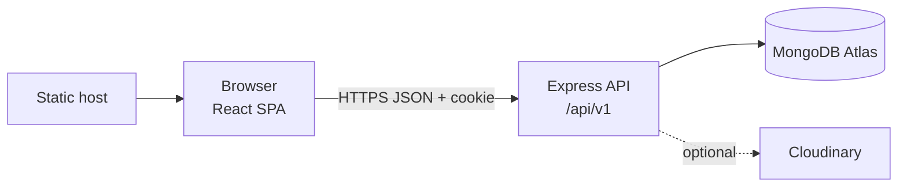

# Architecture

## Monorepo

npm workspaces: `backend`, `frontend`, `e2e`. Shared tooling (ESLint flat config, Prettier) lives at the root.

## Backend layering

`routes → controllers → services → models`, with `middleware`, `validators` (Zod) and `utils` alongside.

- **Routes** (`src/routes/index.ts`) wire URL + auth middleware + validators to a controller. Seller and admin routers apply `authenticate` + `requireSeller` / `requireAdmin` once for the whole router.
- **Controllers** are thin: parse the request, call a service, shape the response envelope `{ success, message, data[, pagination] }`.
- **Services** hold every business rule (pricing, stock, order splitting, status transitions, commission, returns). They are the unit-tested core.
- **Models** are Mongoose schemas with the indexes the queries need.
- Errors are `ApiError` instances turned into JSON by one error middleware; unknown errors never leak internals.

## Key decisions

| Decision | Why |
| --- | --- |
| Roles as an **array** | A person can be buyer + seller + admin without separate accounts. Guards check membership, never a single role. |
| Server-side authority | The client never sends prices, totals, commission or roles that are trusted. Checkout recomputes everything from the database. |
| **Parent Order + SellerOrder** | A cart spanning sellers becomes one payment/receipt (`Order`) and one fulfilment unit per seller (`SellerOrder`) so each seller sees and ships only their items. |
| **Snapshots** on order items | Product name, image, SKU, unit price and shop name are copied at purchase so later edits never rewrite history. |
| **Atomic stock** | Stock is decremented with a conditional `findOneAndUpdate({ stock: { $gte: qty } })`; a failure rolls back earlier decrements and returns `409 INSUFFICIENT_STOCK`. |
| **Idempotency** | `Idempotency-Key` + unique `(buyer, idempotencyKey)` index: a double-click or retry returns the original order instead of charging twice. |
| Access token in **memory**, refresh in **httpOnly cookie** | Limits XSS exposure of long-lived credentials. Refresh tokens rotate; reuse of an old token revokes the family. |
| Derived order status | `deriveOrderStatus(fulfilment[], paymentStatus)` computes the parent status from its sub-orders so it can never disagree with them. |
| Simulated money | `PayoutRecord`, `CommissionRecord` and payment results exist to model the flow; nothing talks to a payment provider. |

## Auth flow

1. `POST /auth/login` → `{ accessToken }` in the body, refresh token in an httpOnly cookie.
2. Axios attaches `Authorization: Bearer …`. On `401` the client calls `/auth/refresh` **once** (shared across concurrent requests), retries the original request, or signs the user out.
3. On page load `AuthContext` calls `/auth/refresh` then `/auth/me` to restore the session.
4. Five failed logins lock the account for 15 minutes.

## Frontend

React 19 + Vite + MUI. Context API for settings, theme, notifications, auth and cart. React Router 7 with lazy route chunks; `RequireRole` guards (`decideAccess` is a pure, tested function). Forms use React Hook Form + Zod. Server data goes through small `useAsync` / `useAction` hooks and the typed clients in `src/api/services.ts`. Guards on the client are UX only — the API enforces every permission.

## Security controls

Helmet, CORS allow-list, rate limiting (stricter on auth), Zod validation with unknown-key stripping, bcrypt password hashing, upload type verified by magic bytes + 5 MB limit, audit log of admin actions, no secrets in the repository (`.env` is git-ignored; production refuses to start without strong secrets).
